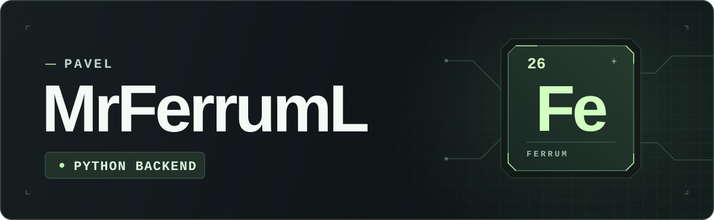

Я Павел. Разрабатываю бэкенд на Python, проектирую API и применяю ML для задач поиска и оценки рисков.

`Python` · `Django` · `FastAPI` · `PostgreSQL` · `Docker`

## Инфокод

Платформа для подготовки к ЕГЭ по информатике и физике. В ней есть банк задач, курсы и контрольные, а в кабинете преподавателя виден прогресс учеников. Для поиска похожих задач используются эмбеддинги.

**[Открыть сайт ↗](https://infocode1.ru/)** · **[Посмотреть архитектуру и скриншоты ↗](https://github.com/MrFerrumL/infocode#readme)**

## Другие проекты

- **[PostCode Challenge](https://github.com/MrFerrumL/postcode-challenge)** — сервис, который превращает данные из Excel в план на шесть спринтов, учитывает навыки команды и показывает риски. `FastAPI` · `SQLite`
- **[Умный кредитный кабинет](https://github.com/MrFerrumL/alpha-smart-credit-cabinet)** — хакатонный прототип с полным циклом кредитной заявки и воспроизводимой ML-моделью риска на синтетических данных. `FastAPI` · `PostgreSQL` · `Docker`
- **[Claude VPN Guard](https://github.com/MrFerrumL/claude-vpn-guard)** — утилита в трее Windows, которая запускает Claude Desktop при активном VPN и закрывает его при потере соединения. `C#` · `WinForms`

---

**[Написать в Telegram ↗](https://t.me/Fucject)** · [Все репозитории ↗](https://github.com/MrFerrumL?tab=repositories)
